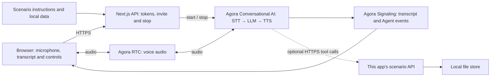

# Service Feedback Survey

Turn a short post-support conversation into confirmed, structured feedback.

[Try locally](#2-try-the-demo) · [Source on GitHub](https://github.com/littleDogWang/03-customer-survey) · [Build with AI](#build-with-ai)

TypeScript · Web · Next.js 16 / React 19 · Agora Conversational AI

## 1. Overview

A considerate voice interviewer gathers feedback about a recent support experience: resolution, a 1–5 CSAT score, the reason, one improvement and explicit contact consent. It asks one question at a time and reviews the summary before any configured save.

- A short interview that skips questions the customer has already answered.
- Conditional follow-ups for low ratings or unresolved issues, with contact consent kept separate.
- Optional JSON result persistence with a server-derived follow-up flag and session-based duplicate protection.

**Default conversation:** The questionnaire and verbal review work without business tools. Answers are not saved and no follow-up is scheduled.

**With business tools enabled:** `save_survey_result` saves reviewed answers as local JSON. Complete results require resolution and a 1–5 rating; partial answers can be saved as abandoned with the user's agreement.

**Scope:** A follow-up flag records need, not permission or a scheduled callback. Ending the survey in the UI stops voice and does not save unsubmitted answers. There is no CRM write, refund or support-ticket update.

## 2. Try the Demo

Run [Quick Start](#5-quick-start), open [http://localhost:3000](http://localhost:3000), allow microphone access and choose **Start feedback survey**. A voice session starts only after your action. The Agora project must be configured even in default conversation mode; “local data” does not mean offline speech or a local LLM.

| Try | Say | Expected behavior |
| --- | --- | --- |
| Give feedback | My issue is still unresolved, and I would rate the service 2 out of 5. | The interviewer uses those answers and asks a relevant follow-up without repeating the rating question. |
| Correct the summary | Actually, make that 3 out of 5. I do not want anyone to contact me. | The review reflects the correction and explicit refusal of contact. |
| Stop early | I need to stop now. | It stops the questionnaire; in tool mode, it asks before saving only confirmed partial answers. |

Rows that describe tool actions require the optional public HTTPS tool configuration. In default mode, expect the limitations described above. These are acceptance cases to try, not a claim that a live voice run has passed. For the full scenario matrix, see [acceptance.md](docs/scenario/acceptance.md).

## 3. Architecture & Tech Stack



| Component | Role |
| --- | --- |
| Agora RTC | Carries user microphone audio and synthesized Agent speech. |
| Agora Signaling (RTM) | Delivers transcript, Agent state, metrics and error events to the browser. |
| Agora Conversational AI | Runs the managed voice pipeline and configured business tools. |
| Next.js route handlers | Keep the App Certificate server-side, issue combined RTC/RTM tokens and manage Agent sessions. |
| Scenario modules | Supply instructions, demo data and the optional business API/tool contracts. |

The client uses `agora-rtc-react`, `agora-rtc-sdk-ng`, `agora-rtm` and `agora-agent-client-toolkit`; the server uses `agora-agents`. The configured pipeline is Deepgram nova-3 → OpenAI gpt-4o-mini → MiniMax speech_2_6_turbo with English speech. See [the invite route](app/api/invite-agent/route.ts) and [runtime profile](lib/runtime-profile.ts) when changing providers. No separate vendor API key is required for the default Agora-managed configuration.

## 4. Prerequisites & Configuration

- Node.js 22 or newer and pnpm 9.15.9.
- An Agora project with its App Certificate enabled, and access to RTC, Signaling and Conversational AI.
- Access to this repository. Cloning or sharing the source requires appropriate repository permissions.
- A browser with microphone access; use HTTPS for a hosted app.

| Variable | Required? | Where / purpose |
| --- | --- | --- |
| `NEXT_PUBLIC_AGORA_APP_ID` | Required | App ID from your Agora Console project. |
| `NEXT_AGORA_APP_CERTIFICATE` | Required | App Certificate from the same project; server-side only. |
| `TOP_TEN_SCENARIO_TOOL_BASE_URL` | Optional | Public HTTPS origin of this same app, reachable by Agora cloud; enables the business tools described below. |
| `TOP_TEN_DATA_DIR` | Optional | Optional writable persistent directory for survey results; defaults to .scenario-data. |

Create or select your project in [Agora Console](https://console.agora.io/), copy the App ID and enable/copy its App Certificate. Put them in `.env.local` using [env.local.example](env.local.example). Never prefix the certificate with `NEXT_PUBLIC_`, put it in client code or commit it.

Leave `TOP_TEN_SCENARIO_TOOL_BASE_URL` unset for the default conversation. To enable tools, deploy the same app at a reachable public HTTPS origin, set that variable on the server, restart/redeploy and start a fresh conversation. HTTP, localhost/private origins, malformed URLs and URLs with credentials, query or fragment are rejected. URL validation does not establish actual cloud reachability. In tool mode, a failed call must not be disguised as a successful fixture-based action.

## 5. Quick Start

From a terminal, clone this scenario rather than the generic starter:

```bash
git clone https://github.com/littleDogWang/03-customer-survey.git
cd 03-customer-survey
pnpm install --frozen-lockfile
cp env.local.example .env.local
```

Edit `.env.local` and fill the two required Agora values from section 4. Then run these commands from the cloned repository root:

```bash
pnpm run doctor
pnpm run dev
```

Alternatively, if the [Agora CLI](https://github.com/AgoraIO/cli) is already installed, bind your project with `agora login`, `agora quickstart env write . --template nextjs --project <your-project> --json` instead of manually copying credentials. Use your actual project identifier in place of `<your-project>`.

Open [http://localhost:3000](http://localhost:3000), choose **Start feedback survey**, allow the microphone and try the first conversation above. Check that you can hear the assistant and see both speakers in the transcript. Then verify the scenario result under the configured mode; a transcript alone does not establish that a business action occurred.

## 6. How It Works

| User step | Assistant / application behavior | Result |
| --- | --- | --- |
| Agree to a short feedback interview | Ask about resolution, rating and relevant context one question at a time. | Confirmed answers and explicitly unanswered fields. |
| Provide an improvement and contact preference | Keep consent independent from dissatisfaction or follow-up need. | A faithful summary for the user to review. |
| Confirm or correct the review | Call save_survey_result only when available and appropriate. | A confirmed save response, or an honest explanation that this session cannot save. |

### Tools and result semantics

`save_survey_result` calls `POST /api/scenarios/03-customer-survey/results` with `session_id`, `answers` and `status`. The invite supplies the RTC channel as the survey session ID. The first saved record for that session wins; retries return the existing result. `results.ts` derives the storage path; server route validation determines follow-up need.

The invite body contains `requester_id` and `channel_name`; the server supplies the channel as survey `session_id`. The supplied browser already handles this startup sequence. See [the scenario guide](docs/scenario/README.md) for additional behavior and contracts.

## 7. Customize for Your Business

| Change | Source | How |
| --- | --- | --- |
| Interview and consent | [config.ts](lib/agent-config.ts) | Change questions and review language without inferring skipped answers or contact permission. |
| Result schema and persistence | [results.ts](lib/customer-survey/results.ts) | Extend the typed result and storage deliberately; synchronize route validation and tool schema. |
| Presentation | [presentation.ts](lib/presentation.ts) | Describe the support experience being surveyed and the expected outcome. |

To send feedback to your CRM, adapt the results route after validating the confirmed payload. Preserve session-based duplicate handling and distinguish a successful CRM write from a failed delivery. Test a low score with contact refused: follow-up need may be true while consent remains false.

Shared integration points:

- [lib/agent-config.ts](lib/agent-config.ts) assembles the selected scenario prompt.
- [lib/agent-tools.ts](lib/agent-tools.ts) defines business tool schemas and server-bound routes.
- [app/api/invite-agent/route.ts](app/api/invite-agent/route.ts) selects the prompt, providers, turn detection and session settings.
- [lib/presentation.ts](lib/presentation.ts) selects the scenario presentation; edit its scenario module for visible content.
- [docs/ai/RECIPE.md](docs/ai/RECIPE.md) retains the machine-readable integration profile and lifecycle contracts.

Keep combined RTC/RTM token generation, the StrictMode initialization guard, toolkit local-user UID remapping and interrupted transcript turns intact. Let the Agora React hooks own microphone and RTC teardown. Preserve server-bound business session scope when extending tools.

### Build with AI

After cloning this repository, paste the following into your coding agent from your own application workspace, providing the path to the clone:

```text
Implement the Service Feedback Survey recipe in my application.

Read RECIPE.md in the cloned 03-customer-survey repository first, then inspect
its scenario modules, tool contracts and invite route. Read docs/ai/RECIPE.md
and AGENTS.md in that repository for integration constraints.

Inspect my application's existing stack and instructions before editing.
Reuse the source's RTC/RTM token, session and transcript patterns.
Implement the scenario's default conversation first, then connect only the
business tools I request. Keep demo data and real service results distinct.
Explain the credentials and configuration I need to supply.
Ask before adding dependencies. Follow my rules for local edits, verification,
commits and remote writes. Verify the result without claiming unrun live tests.
```

This prompt is a source-guided integration entry point, not a published scaffolding package or an automatic Console import.

## 8. Deployment & Validation

### Deploy

Use one Node process and a writable persistent directory for saved results. Set `TOP_TEN_DATA_DIR` to that directory; the default is `.scenario-data`. Ephemeral serverless disk does not provide durable survey storage. For multi-instance use, replace the local JSON store with shared storage.

Install dependencies and set the same required environment variables in your deployment platform's secret store. Build with `pnpm run build` and, on a Node host, start with `pnpm run start`. Keep the public app on HTTPS. For voice tools, set `TOP_TEN_SCENARIO_TOOL_BASE_URL` to the deployed app's reachable HTTPS origin and verify cloud callbacks against that same running instance.

These commands describe the repository's supported scripts; they do not attest to an existing deployment. Before opening sample endpoints to real users, add application authentication, authorization and appropriate request limits.

### Docker deployment

```bash
docker build --build-arg NEXT_PUBLIC_AGORA_APP_ID=YOUR_AGORA_APP_ID -t 03-customer-survey:local .
docker run --rm -p 3000:3000 --env-file .env.local --mount source=03-customer-survey-data,target=/app/.scenario-data 03-customer-survey:local
```

Replace `YOUR_AGORA_APP_ID` with the public App ID used in `.env.local`. Next.js embeds that identifier in the browser bundle, so changing projects requires rebuilding the image. The App Certificate is supplied only at container runtime. The named volume preserves the non-root-owned `.scenario-data` directory. Leave custom host storage variables unset inside Docker or map them to the mounted directory; a host absolute path is not automatically mounted.

`pnpm run verify:docker` independently builds the image with synthetic credentials, starts an isolated localhost-bound container, checks the home page and a scenario route, then removes only that container. It does not contact Agora or prove a live voice session.

### Check locally

From this repository root:

```bash
pnpm run verify:template
pnpm run lint
pnpm run typecheck
pnpm run verify:api
pnpm run verify:scenario
pnpm run build
```

With the local prerequisites and credentials configured, also run `pnpm run verify`. The canonical verify script includes all of the local scenario checks above; Docker is deliberately verified separately. Local checks do not require a real microphone call and do not prove cloud tool execution.

### Verify a real conversation

1. Start a fresh voice session; check two-way audio and both transcript speakers.
2. Try the normal, correction and unsupported/failure paths in section 2.
3. Test a completed survey, a consented early exit and a correction before save. Check the actual result response/file. End the UI without saving in another call and verify that it does not invent a saved result.
4. End the call and confirm that microphone publication and the Agent session stop. Keep evidence of the actual result separately from the transcript.

### Troubleshooting

| Symptom | Check |
| --- | --- |
| Agent does not join | Check the token/invite response and run pnpm run doctor. If using the Agora CLI, run agora project doctor --deep. |
| Audio works but transcript is missing | Check RTM login/subscription and keep RtcTokenBuilder.buildTokenWithRtm in the token route. |
| Browser has no microphone | Grant permission, select an input device and use localhost or a secure HTTPS page. |
| The assistant discusses the task but does not save or change it | Check whether the optional public tool origin is enabled. The default conversation has the limits in section 1. |
| A tool fails or a result disappears | Inspect the actual API error, callback reachability and this scenario's storage/lifetime limits; do not claim success from speech alone. |

See [the contributor guide](AGENTS.md), [scenario guide](docs/scenario/README.md) and [MIT License](LICENSE) for further details.
